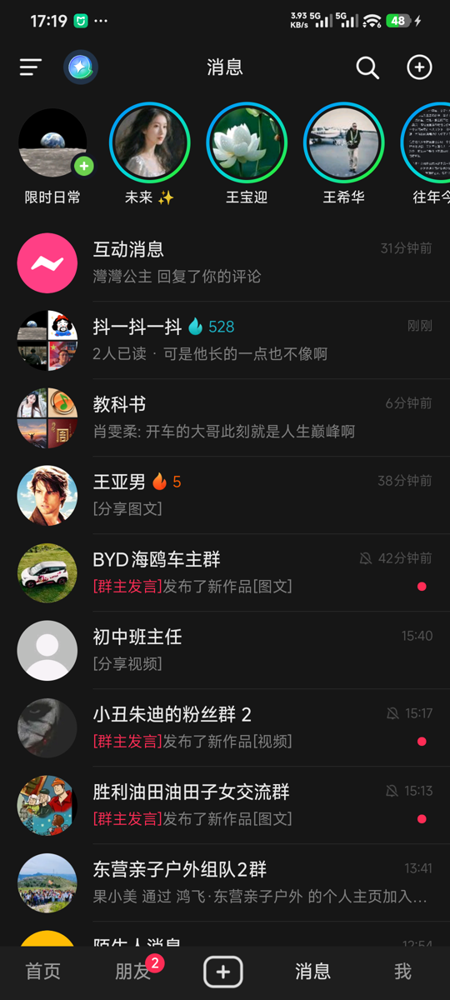
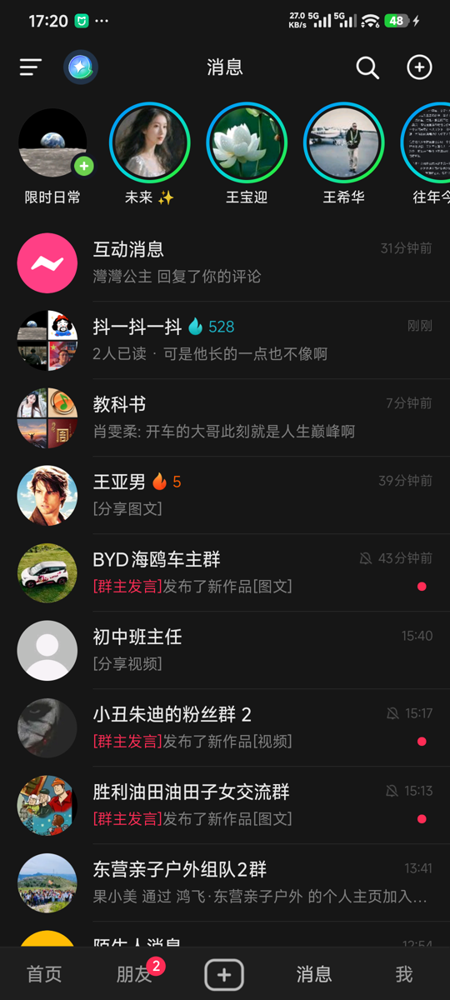

# 日出闹钟 (Sunrise Alarm)

基于 NOAA 天文算法离线计算日出日落的智能闹钟。**本仓库同时收录两个平台的实现**：

| 平台 | 目录 | 版本 | 说明 |
|------|------|------|------|
| Android | 仓库根目录 | 1.1.2 (1000008) | Kotlin / Jetpack Compose，见下文 |
| HarmonyOS | [`harmonyos/`](./harmonyos/) | 1.1.2 (1000008) | ArkTS / ArkUI，手机 + 平板（HarmonyOS 5.1+） |

两个平台的包名同为 `com.sunrise.alarm`，界面、文案、颜色、版本号都对齐。

| 首页 | 新建闹钟 | 设置 | English |
|:---:|:---:|:---:|:---:|
|  |  |  |  |

以下为 **Android 版**文档。

## 功能

- **日出/日落闹钟**：根据当前位置自动计算日出日落时间，支持提前/延后偏移
- **自动定位**：GPS 自动获取当前位置，实时更新日出日落时间
- **手动位置**：支持搜索城市或手动输入经纬度
- **普通闹钟**：也可作为传统闹钟使用，设定固定时间
- **离线计算**：日出日落时间基于 NOAA 算法本地计算，无需网络
- **滚动时间选择**：新建闹钟的时间选择是上下无限循环的滚轮，滑到 59 分钟自然接上 00
- **中英双语**：界面文案跟随系统语言，也可在「设置 → 语言」里手动锁定中文 / English；
  地名会跟着界面语言走（英文界面显示 `Dongying` 而不是「东营市」）
- **深浅色**：暗色（暖橙）/ 浅色两套主题，「设置 → 外观」切换
- **隐私合规**：首次启动弹出隐私政策，同意之前不申请任何权限、不读取定位

## 技术栈

- **语言**：Kotlin
- **UI**：Jetpack Compose + Material3
- **架构**：MVVM (ViewModel + StateFlow)
- **数据库**：Room
- **导航**：Navigation Compose
- **定位**：Google Play Services Location
- **闹钟调度**：AlarmManager + 前台服务
- **最低 SDK**：Android 8.0 (API 26)
- **目标 SDK**：Android 14 (API 34)

## 项目结构

```
SunriseAlarm/
├── app/
│   ├── build.gradle.kts
│   ├── proguard-rules.pro
│   └── src/main/
│       ├── AndroidManifest.xml
│       ├── java/com/sunrise/alarm/
│       │   ├── MainActivity.kt              # 入口 Activity（隐私门禁 + 切语言整树重建）
│       │   ├── SunriseAlarmApp.kt           # Application 类（冷启动注入语言偏好）
│       │   ├── common/
│       │   │   └── I18n.kt                   # 中英双语词库 + 当前语言单例
│       │   ├── data/                         # 数据层
│       │   │   ├── AlarmEntity.kt            # 闹钟实体 + 类型枚举
│       │   │   ├── AlarmDao.kt               # Room DAO
│       │   │   ├── AlarmDatabase.kt          # Room 数据库
│       │   │   ├── AlarmRepository.kt        # 仓库
│       │   │   ├── LocationPreferences.kt    # 位置偏好存储
│       │   │   ├── ThemePreferences.kt       # 主题偏好（深/浅/跟随系统）
│       │   │   ├── LanguagePreferences.kt    # 语言偏好（跟随系统/中文/English）
│       │   │   └── PrivacyConsent.kt         # 隐私政策同意状态（带版本号）
│       │   ├── service/                      # 服务层
│       │   │   ├── LocationService.kt        # GPS 定位服务（地名按界面语言返回）
│       │   │   ├── AlarmReceiver.kt          # 闹钟广播接收器
│       │   │   ├── AlarmRingService.kt       # 响铃前台服务
│       │   │   └── BootReceiver.kt           # 开机自启
│       │   ├── util/                         # 工具
│       │   │   ├── SunriseSunsetCalculator.kt # NOAA 日出日落算法
│       │   │   └── AlarmScheduler.kt         # 闹钟调度器
│       │   └── ui/                           # UI 层
│       │       ├── theme/                    # 主题（暗色暖橙 / 浅色）
│       │       ├── navigation/               # 导航（底部三 Tab）
│       │       ├── home/                     # 主页（日出卡片 + 闹钟列表）
│       │       ├── addalarm/                 # 新建/编辑闹钟（循环滚轮时间选择）
│       │       ├── location/                 # 位置设置
│       │       ├── settings/                 # 设置（外观 / 语言 / 关于）
│       │       ├── privacy/                  # 隐私政策弹窗
│       │       └── ring/                     # 响铃页
│       └── res/                              # 资源
│           ├── values/                       # 字符串、颜色、主题（默认中文）
│           ├── values-en/                    # 系统直接读取的英文项：应用名、权限说明、通知渠道
│           ├── drawable/                     # 图标
│           └── xml/                          # 备份规则
├── build.gradle.kts
├── settings.gradle.kts
├── gradle.properties
└── gradle/wrapper/                           # wrapper 已随仓库提供，开箱即用
```

> 界面文案为什么不走 `values-en/strings.xml`：ViewModel、通知、Room 实体都拿不到 `Context`，
> 原生资源每个调用点都要塞一个 Context 进去。词库集中在 `common/I18n.kt`，还能和鸿蒙版
> `I18n.ets` 逐 key 对照，漏翻一眼就能看出来。`values-en/` 只放系统层面会直接读取的少量文案。

## 构建方法

### 方法一：Android Studio（推荐）

1. 打开 Android Studio
2. 选择 `File > Open`，选择 `SunriseAlarm` 目录
3. 等待 Gradle 同步完成
4. 点击 `Run` 按钮编译并运行

### 方法二：命令行

仓库已带 Gradle Wrapper，直接跑即可：

```bash
cd SunriseAlarm
./gradlew assembleDebug      # 输出 app/build/outputs/apk/debug/app-debug.apk
./gradlew assembleRelease    # 需自备签名，见下
```

### 签名

`keystore/` 与 `keystore.properties` **不在仓库里**（已加入 `.gitignore`）。要打正式包，
在工程根目录放一份 `keystore.properties`：

```properties
storeFile=keystore/your-release.jks
storePassword=***
keyAlias=***
keyPassword=***
```

`app/build.gradle.kts` 检测到这个文件才会挂上 release 签名，缺省时打出来的 release 包未签名。

> 签名证书丢了就永远无法更新这个应用，务必离线备份。

## 权限说明

| 权限 | 用途 |
|------|------|
| `SCHEDULE_EXACT_ALARM` | 精确闹钟调度 |
| `USE_EXACT_ALARM` | Android 13+ 精确闹钟 |
| `WAKE_LOCK` | 唤醒设备 |
| `RECEIVE_BOOT_COMPLETED` | 开机后恢复闹钟 |
| `VIBRATE` | 闹钟振动 |
| `POST_NOTIFICATIONS` | 闹钟通知 |
| `FOREGROUND_SERVICE` | 响铃前台服务 |
| `FOREGROUND_SERVICE_ALARM` | Android 14+ 闹钟服务类型 |
| `ACCESS_FINE_LOCATION` | GPS 精确定位 |
| `ACCESS_COARSE_LOCATION` | 粗略定位 |

## 设计稿

设计稿地址：https://ardot.tencent.com/file/708996051042477

主题色：暗色背景 `#161618`，暖橙强调色 `#FF8C42`，日出日落渐变。

## HarmonyOS 版

见 [`harmonyos/README.md`](./harmonyos/README.md)。当前 1.1.1，单 `entry` HAP，支持
phone / tablet，最低兼容 HarmonyOS 5.1 (API 18)。
NOAA 算法、闹钟实体、时间格式等纯逻辑层与 Android 版保持一致，平台层（代理提醒、定位、存储、服务卡片）重写。
界面文案走内嵌的中英双语词条，跟随系统语言，也可在「设置 → 语言」里手动切换。

> 1.1.1 起不再包含手表端（原 `wearable` 模块已移除），发布设备类型为手机 / 平板。

> 该目录的 `build-profile.json5` 是脱敏版，不含签名证书与口令；本地打包需自行配置签名。
